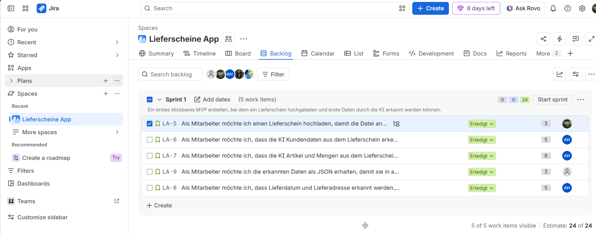
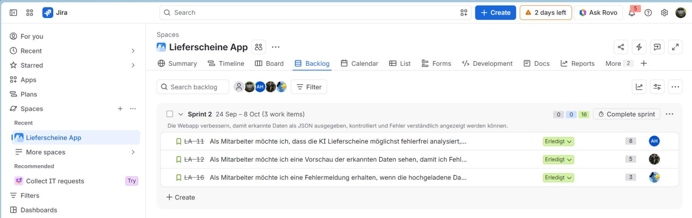
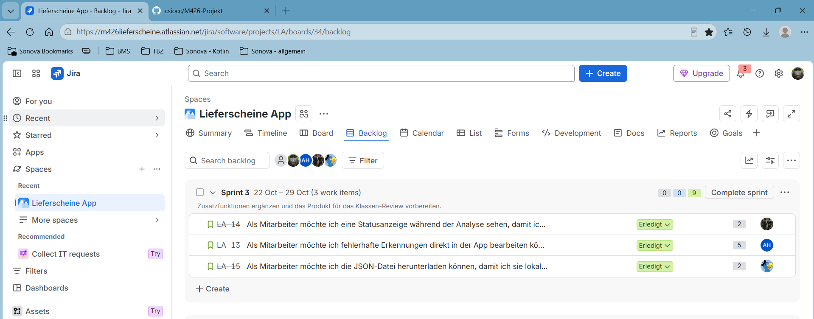

# Portfolio Scrum-Experiment

## 1. Team und Produkt

| Punkt          | Inhalt                                                                   |
| -------------- | ------------------------------------------------------------------------ |
| Teamname       | SCRUM-Team 5                                                             |
| Teammitglieder | Dzanis Tojaga, Christian Siegrist, Melvin Jenni, Semin Banovi, Andy Hess |
| Product Owner  | Semin Banovi                                                             |
| Scrum Master   | Dzanis Tojaga                                                            |
| Produktname    | Lieferscheine Webapp                                                     |
| Zielgruppe     | Unternehmen, KMU, Firmen                                                 |

## 2. Product Vision

Unsere Lieferscheine Webapp soll Unternehmen dabei helfen, Lieferscheine schneller und mit weniger manueller Arbeit zu verarbeiten. Viele Daten aus Lieferscheinen müssen sonst von Hand abgetippt werden. Das kostet Zeit und kann zu Fehlern führen.

Die Zielgruppe sind Unternehmen, KMU und Firmen, die Lieferscheine digital weiterverarbeiten möchten.

Das Produkt löst das Problem, dass Informationen aus Lieferscheinen manuell erfasst werden müssen. Die Webapp soll einen Lieferschein hochladen, mit KI analysieren und die erkannten Daten strukturiert als JSON ausgeben.

Das erste realistische Produktinkrement ist ein klickbarer MVP. Dabei soll ein Lieferschein hochgeladen und erste Daten durch die KI erkannt werden.

Link oder Screenshot:
[Product Vision Board in Miro](https://miro.com/app/board/uXjVHtqin6U=/)

## 3. Product Backlog

### Wichtigstes Epic

Als Mitarbeiter möchte ich Lieferscheine mit KI analysieren und die erkannten Daten verwalten, damit Lieferinformationen zuverlässig als JSON weiterverwendet werden können.

### Wichtigste User Stories

| User Story                                  | Priorität   | Akzeptanzkriterien vorhanden? | Bemerkung                                                 |
| ------------------------------------------- | ----------- | ----------------------------- | --------------------------------------------------------- |
| Lieferschein hochladen                      | Must-have   | Ja                            | Grundlage, damit die Datei analysiert werden kann         |
| Kundendaten erkennen                        | Must-have   | Ja                            | Wichtige Daten müssen nicht manuell erfasst werden        |
| Artikel und Mengen erkennen                 | Must-have   | Ja                            | Zentrale Informationen aus dem Lieferschein               |
| Lieferdatum und Lieferadresse erkennen      | Must-have   | Ja                            | Macht die Lieferinformationen vollständiger               |
| JSON-Ausgabe erstellen                      | Must-have   | Ja                            | Ergebnis kann in anderen Systemen weiterverwendet werden  |
| KI möglichst fehlerfrei analysieren         | Should-have | Ja                            | Verbessert die Zuverlässigkeit der erkannten Daten        |
| Vorschau der erkannten Daten anzeigen       | Should-have | Ja                            | Fehler können vor dem Export erkannt werden               |
| Statusanzeige während Analyse anzeigen      | Should-have | Ja                            | Benutzer sieht, ob die Verarbeitung läuft oder fertig ist |
| Fehlermeldung bei ungültiger Datei anzeigen | Should-have | Ja                            | Benutzer erkennt, welche Dateien unterstützt werden       |
| Fehlerhafte Erkennungen bearbeiten          | Could-have  | Ja                            | Erkannte Daten können direkt korrigiert werden            |
| JSON-Datei herunterladen                    | Could-have  | Ja                            | JSON kann lokal gespeichert werden                        |

### Vollständige User Stories

1. Als Mitarbeiter möchte ich einen Lieferschein hochladen, damit die Datei analysiert werden kann.
2. Als Mitarbeiter möchte ich, dass die KI Kundendaten aus dem Lieferschein erkennt, damit diese nicht manuell erfasst werden müssen.
3. Als Mitarbeiter möchte ich, dass die KI Artikel und Mengen aus dem Lieferschein erkennt, damit die gelieferten Positionen automatisch ausgelesen werden.
4. Als Mitarbeiter möchte ich, dass Lieferdatum und Lieferadresse erkannt werden, damit die Lieferinformationen vollständig sind.
5. Als Mitarbeiter möchte ich die erkannten Daten als JSON erhalten, damit sie in anderen Systemen weiterverwendet werden können.
6. Als Mitarbeiter möchte ich, dass die KI Lieferscheine möglichst fehlerfrei analysiert, damit die ausgegebenen JSON-Daten zuverlässig sind.
7. Als Mitarbeiter möchte ich eine Vorschau der erkannten Daten sehen, damit ich Fehler vor dem Export korrigieren kann.
8. Als Mitarbeiter möchte ich eine Statusanzeige während der Analyse sehen, damit ich weiss, ob die Verarbeitung noch läuft oder abgeschlossen ist.
9. Als Mitarbeiter möchte ich eine Fehlermeldung erhalten, wenn die hochgeladene Datei kein gültiges Bild/PDF ist, damit ich weiss, welche Formate unterstützt werden.
10. Als Mitarbeiter möchte ich fehlerhafte Erkennungen direkt in der App bearbeiten können, damit ich das JSON nicht manuell nachbearbeiten muss.
11. Als Mitarbeiter möchte ich die JSON-Datei herunterladen können, damit ich sie lokal speichern kann.

### Priorisierungsmethode

Wir haben die MoSCoW-Methode verwendet. Diese Methode hilft uns zu unterscheiden, welche Funktionen für das MVP zwingend nötig sind und welche Funktionen später umgesetzt werden können.

### Wichtigste Scope-Entscheide

Für Sprint 1 konzentrieren wir uns auf die wichtigsten MVP-Funktionen: Upload, KI-Erkennung und eine erste strukturierte Ausgabe. Verbesserungen wie Vorschau, bessere Fehlerbehandlung und Download-Funktionen werden später eingeplant.

### Definition of Done

Eine User Story gilt für uns als erledigt, wenn:

- die Funktion umgesetzt und lauffähig ist,
- die Akzeptanzkriterien erfüllt sind,
- die Funktion getestet wurde,
- der Code im Repository vorhanden ist,
- die Funktion im Review gezeigt werden kann,
- Jira aktualisiert wurde.

## 4. Sprint-Dokumentation

### Sprint 1

| Punkt | Inhalt |
|---|---|
| Sprintziel | Ein erstes klickbares MVP erstellen, bei dem ein Lieferschein hochgeladen, wichtige Daten durch die KI erkannt und als JSON ausgegeben werden können. |
| Ausgewählte User Stories | Upload, Kundendaten, Artikel und Mengen, Lieferdatum und Lieferadresse, JSON-Ausgabe |
| Review-Ergebnis | Alle fünf User Stories wurden umgesetzt, im Review gezeigt und vom Product Owner akzeptiert. Das Sprintziel wurde erreicht. |
| Retro-Erkenntnis | Die Aufgabenverteilung, Kommunikation und Zusammenarbeit im Team haben gut funktioniert. Es wurden keine grösseren Probleme festgestellt. |
| Verbesserungsmassnahme für Sprint 2 | Es wurden keine neuen Verbesserungsmassnahmen beschlossen. |

#### Nachweis Sprint 1

### Sprint 2

| Punkt | Inhalt |
|---|---|
| Sprintziel | Die Webapp verbessern, damit die KI zuverlässiger arbeitet und die erkannten Daten verständlich kontrolliert werden können. |
| Ausgewählte User Stories | Bessere KI-Analyse, Vorschau der erkannten Daten, Fehlermeldung bei ungültiger Datei |
| Review-Ergebnis | Alle drei User Stories wurden umgesetzt, im Review gezeigt und vom Product Owner akzeptiert. Das Sprintziel wurde erreicht. |
| Retro-Erkenntnis | Die Aufgabenverteilung, Kommunikation und Zusammenarbeit im Team haben gut funktioniert. Es wurden keine grösseren Probleme festgestellt. |
| Verbesserungsmassnahme für Sprint 3 | Es wurden keine neuen Verbesserungsmassnahmen beschlossen. |

#### Nachweis Sprint 2

### Sprint 3

| Punkt | Inhalt |
|---|---|
| Sprintziel | Zusatzfunktionen ergänzen und das Produkt für das Klassen-Review vorbereiten. |
| Ausgewählte User Stories | Statusanzeige während der Analyse, fehlerhafte Erkennungen bearbeiten, JSON-Datei herunterladen |
| Review-Ergebnis | Alle drei User Stories wurden umgesetzt und im Review erfolgreich gezeigt. Das Sprintziel wurde erreicht. |
| Retro-Erkenntnis | Die Aufgabenverteilung, Kommunikation und Zusammenarbeit im Team haben gut funktioniert. Das Team war mit dem Ablauf und dem Ergebnis zufrieden. |
| Vorbereitung Klassen-Review | Im Klassen-Review zeigen wir die fertige Webapp und stellen unsere Erfahrungen aus den drei Sprints, die Zusammenarbeit und unsere KI-Nutzung vor. |

#### Nachweis Sprint 3

## 5. Scrum-Erfahrungen

### Besonders anspruchsvolle Rolle

Die Rolle des Scrum Masters war organisatorisch anspruchsvoll. Die Meetings mussten vorbereitet, Termine mit der Lehrperson vereinbart und der Überblick über den Sprint behalten werden. Dabei war wichtig, dass alle Teammitglieder ihre Aufgaben kannten und offene Fragen gemeinsam geklärt wurden.

### Hilfreichste Zeremonie

Das Sprint Review war besonders hilfreich, weil wir die umgesetzten Funktionen gemeinsam anschauen und ausprobieren konnten. So wurde sichtbar, was wir im Sprint erreicht hatten und ob das Ergebnis zu unserem Sprintziel passte.

### Unterstützung durch Scrum

Scrum hat uns geholfen, das Projekt in überschaubare Schritte aufzuteilen. Durch die Sprintziele und die ausgewählten User Stories wussten wir, worauf wir uns konzentrieren mussten. In Jira konnten wir sehen, wer welche Story bearbeitete und wie weit die Arbeit fortgeschritten war.

### Schwierigkeiten mit Scrum

Zu Beginn mussten wir uns mit den Scrum-Begriffen, den Rollen und dem Ablauf der Meetings vertraut machen. Auch die richtige Zuordnung und Pflege der Stories in Jira brauchte Aufmerksamkeit. Insgesamt haben die Aufgabenverteilung und die Zusammenarbeit gut funktioniert. Grössere Probleme haben wir in den Retrospektiven nicht festgestellt.

### Entwicklung des Product Backlogs

Aus unserer Product Vision entstanden ein Epic und die einzelnen User Stories. Diese wurden mit Akzeptanzkriterien ergänzt, nach MoSCoW priorisiert und mit Story Points geschätzt. Anschliessend wählten wir für jeden Sprint die passenden Stories aus. Die grundlegende Produktidee blieb dabei bestehen.

### Wichtige Scope-Entscheide

Wir konzentrierten uns zuerst auf ein kleines, lauffähiges MVP mit Upload, KI-Erkennung und JSON-Ausgabe. In Sprint 2 verbesserten wir die Zuverlässigkeit der Analyse und ergänzten die Vorschau sowie Fehlermeldungen. Die Statusanzeige, das Bearbeiten erkannter Daten und der JSON-Download folgten in Sprint 3. Dadurch konnten wir zuerst die Grundfunktionen fertigstellen und danach Zusatzfunktionen ergänzen.

## 6. Persönliche Kurzreflexionen

| Name | Beitrag | wichtigste Erkenntnis | nächster Lernschritt |
| ---- | ------- | --------------------- | -------------------- |
| Andy Hess | Zuständig für die KI-Anbindung: Prompt zum Auslesen von Kunde, Artikeln, Mengen, Lieferdatum und Lieferadresse, JSON-Format und der `LieferscheinExtractor` (OpenAI mit Structured Outputs, Bild und PDF) samt Doku und Tests (PR #11). Die sechs Review-Kommentare eingearbeitet und die CI-Fehler (RuboCop, Testsuite) behoben. | Auch KI-generierter Code braucht Review und Tests: Im Review und in der CI sind Lücken aufgefallen, die ich selbst nicht gesehen hatte (Netzwerkfehler, abgeschnittene Antworten, Lint- und Testfehler). Ausserdem gehören API-Keys nie in Code, Repository oder Chat, sondern in Credentials oder Umgebungsvariablen. | Tests und Linter lokal ausführen, bevor ich pushe, und Fehlerfälle von Anfang an mitdenken statt erst im Review. Dazu die Erkennungsqualität der KI mit mehreren echten Lieferscheinen systematisch prüfen. |
| Melvin Jenni | Zuständig für das Frontend: Angular-App mit PrimeNG und Tailwind aufgesetzt, an die Rails-API angebunden und die Ordner sauber aufgeteilt. Die sieben Review-Punkte aus PR #21 eingebaut (z. B. kein doppelter Upload, Dark Mode, Frontend-Tests in der CI). Die Vorschau der erkannten Daten gebaut (LA-12) und die Statusanzeige mit Erfolgsmeldung (LA-14). | Bevor ich etwas Neues baue, schaue ich zuerst, was schon da ist. Bei LA-14 war vieles schon fertig, es fehlte nur die Erfolgsmeldung. Ausserdem habe ich gemerkt: Was die KI baut, muss ich selbst im Browser testen. Meine erste Vorschau mit reinem JSON war für Mitarbeiter zu schwierig, ein Formular ist viel besser. | Mehr eigene Tests schreiben und meine Entwicklungsumgebung aktuell halten. Die Tests liefen bei mir zuerst nicht, weil meine Node-Version zu alt war. |
| Semin Banovi (Product Owner) | Backlog geführt, User Stories geschrieben und priorisiert, Fragen vom Team beantwortet | Unklare Stories kosten im Sprint viel Zeit, deshalb muss ich sie genauer beschreiben | Bessere Akzeptanzkriterien schreiben und früher Feedback einholen |
| Dzanis Tojaga (Scrum Master) | Scrum-Events vorbereitet und moderiert, Termine mit der Lehrperson organisiert, das Jira-Board gepflegt und das Portfolio aktualisiert. Zusätzlich in kleinem Umfang am Code mitgearbeitet und die Developer bei einzelnen Aufgaben unterstützt. | Klare Sprintziele, eine verständliche Aufgabenverteilung und ein aktuelles Board helfen dem Team, den Überblick zu behalten. Als Scrum Master muss ich Gespräche strukturieren und dafür sorgen, dass offene Fragen geklärt werden. | Meetings sicherer moderieren, gezieltere Fragen stellen und Ergebnisse direkt nach den Events dokumentieren. |
| Christian Siegrist | Backend mit Rails aufgebaut, den Datei-Upload mit dem KI-Service verbunden und die Verarbeitung der Ergebnisse umgesetzt. An der JSON-Ausgabe (LA-9), der Fehlermeldung bei ungültigen Dateien (LA-16) und dem JSON-Download (LA-15) gearbeitet. Zusätzlich Tests und Code-Reviews durchgeführt. | Frontend, Backend und KI müssen gut aufeinander abgestimmt sein. Tests und Code-Reviews helfen, Fehler früh zu erkennen und die Zusammenarbeit zwischen den einzelnen Komponenten zu überprüfen. | Fehlerfälle früher berücksichtigen, Schnittstellen klarer mit den anderen Developern abstimmen und automatisierte Tests gezielt erweitern. |

## 7. KI-Nutzungsnachweis

Unsere KI-Nutzung wird in einer separaten Dokumentation festgehalten. Darin dokumentieren wir, wofür KI eingesetzt wurde, welche Ergebnisse übernommen oder verworfen wurden und welche Entscheidungen wir selbst getroffen haben.

[KI-Dokumentation öffnen](./KI-Doku.md)

## 8. Abschlussreflexion

### Was haben wir über agile Softwareentwicklung gelernt?

Wir haben gelernt, ein Produkt schrittweise zu entwickeln und zuerst die wichtigsten Funktionen umzusetzen. In Sprint 1 entstand die Grundlage mit Upload, KI-Erkennung und JSON-Ausgabe. In den weiteren Sprints verbesserten wir die Verarbeitung und ergänzten zusätzliche Funktionen.

Klare User Stories und Akzeptanzkriterien haben uns geholfen, die Anforderungen zu verstehen. Durch die Sprintziele und das Jira-Board konnten wir den Fortschritt verfolgen. In den Reviews haben wir die Ergebnisse gemeinsam überprüft.

### Was würden wir im nächsten Scrum-Projekt anders machen?

Im nächsten Projekt würden wir die Akzeptanzkriterien von Anfang an genauer formulieren und die Schnittstellen zwischen Frontend, Backend und KI früher gemeinsam festlegen. Dadurch können die Developer ihre Arbeit besser aufeinander abstimmen.

Ausserdem würden wir Tests und Fehlerfälle bereits bei der Planung stärker berücksichtigen. Erkenntnisse und die KI-Nutzung würden wir direkt während der Arbeit dokumentieren, damit am Schluss weniger nachgetragen werden muss.

### Welche Best Practice nehmen wir mit?

Wir möchten weiterhin mit kleinen, klar beschriebenen User Stories und überschaubaren Sprintzielen arbeiten. Die Aufteilung in Frontend, Backend und KI hat für unser Team gut funktioniert. Dabei bleibt der regelmässige Austausch wichtig, weil die einzelnen Bereiche zusammen funktionieren müssen.

Besonders bewährt haben sich Code-Reviews, automatisierte Tests und das gemeinsame Ausprobieren der Webapp. Eine Funktion ist erst dann fertig, wenn sie funktioniert und die vereinbarten Akzeptanzkriterien sowie unsere Definition of Done erfüllt.

### Wo hat KI geholfen und wo waren ihre Grenzen?

KI hat uns beim Projektaufbau, bei der Umsetzung von Funktionen, beim Schreiben von Tests und bei der Fehlersuche unterstützt. Auch für die Erkennung der Lieferscheindaten und die strukturierte JSON-Ausgabe war sie ein wichtiger Bestandteil.

Die Vorschläge waren jedoch nicht immer vollständig oder direkt brauchbar. Erst durch eigene Tests, Code-Reviews und die CI wurden beispielsweise fehlende Fehlerbehandlungen oder Probleme mit Abhängigkeiten sichtbar. Auch eine technisch funktionierende Ausgabe war nicht automatisch benutzerfreundlich: Für die Vorschau war ein verständliches Formular geeigneter als reines JSON.

Wir haben deshalb die Ergebnisse geprüft und selbst entschieden, welche Vorschläge wir übernehmen, anpassen oder verwerfen. Die Verantwortung für das Produkt und die Qualität blieb bei unserem Team.
